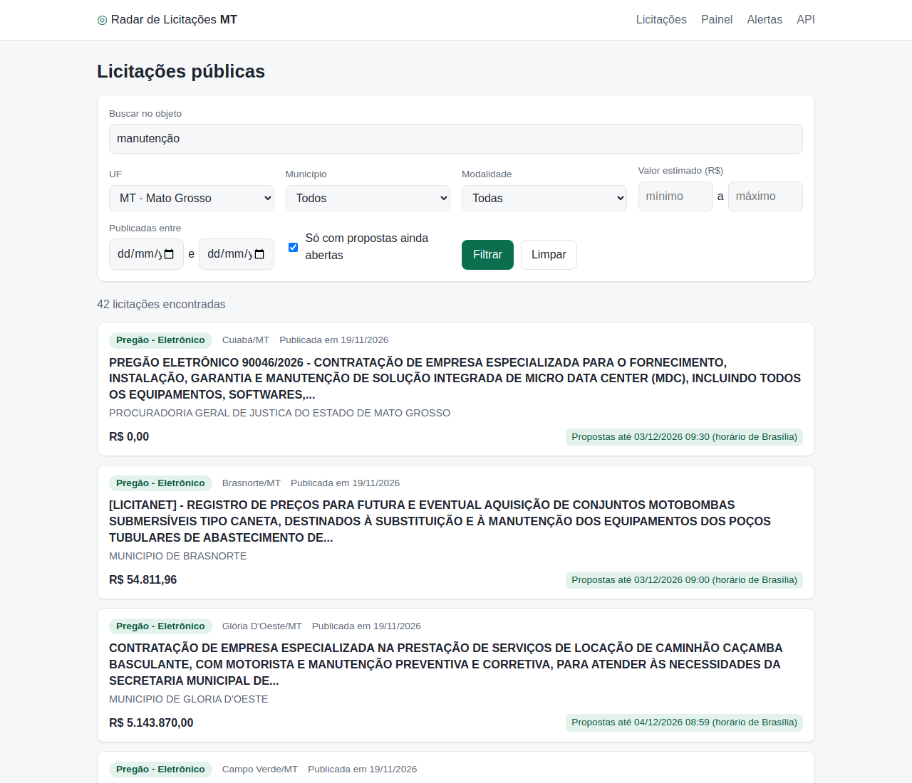
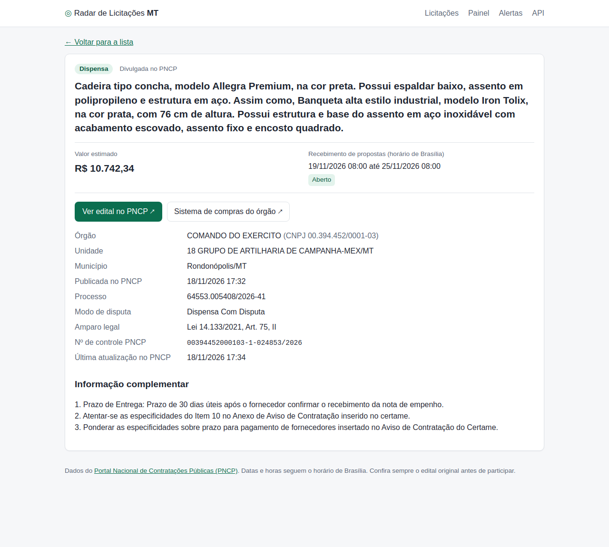
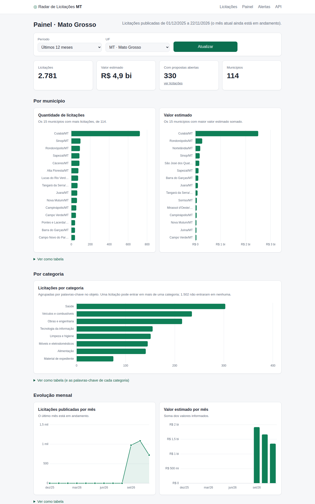
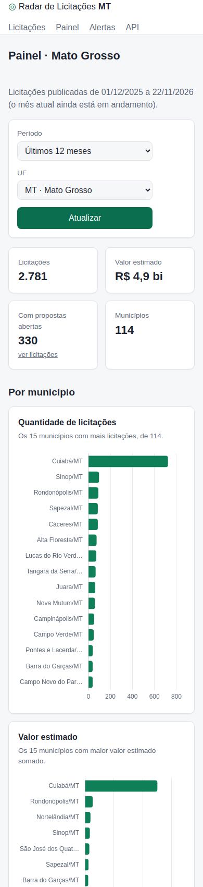
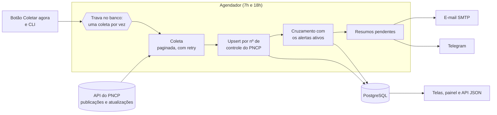
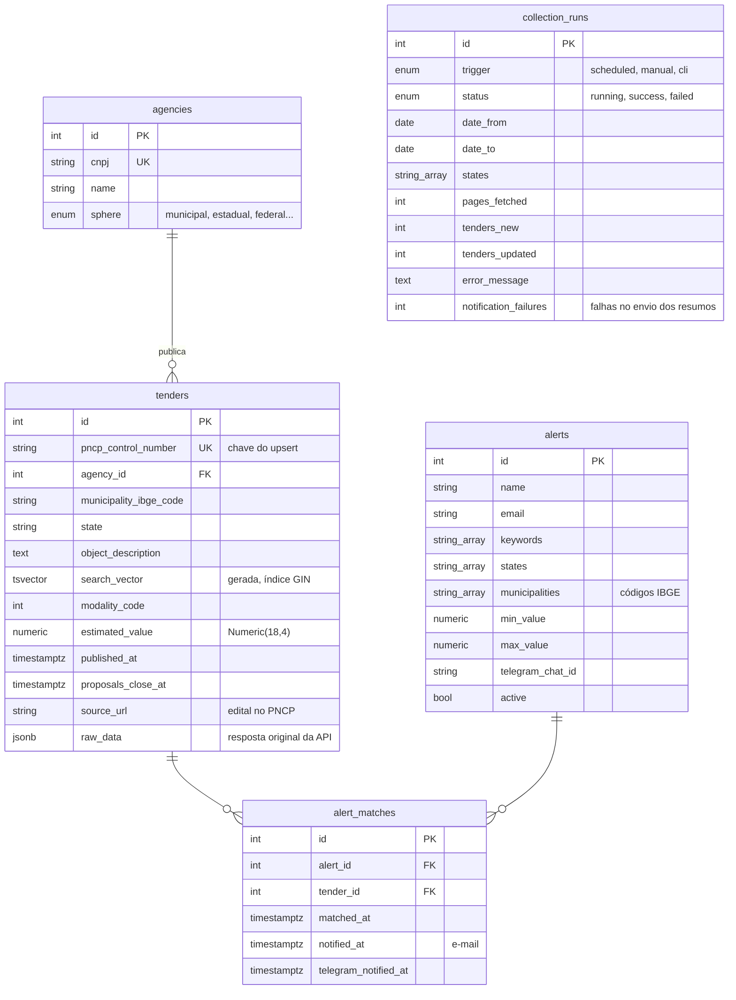

# Radar de Licitações MT

Coleta as contratações publicadas no [PNCP](https://pncp.gov.br) (Portal Nacional de
Contratações Públicas) e avisa pequenas empresas, por e-mail e Telegram, quando surge uma
licitação que combina com as palavras-chave delas. A abrangência padrão é Mato Grosso, mas pode
ser qualquer conjunto de UFs ou o Brasil inteiro.

Exemplo de uso: uma empresa de manutenção e equipamentos de TI de Rondonópolis cadastra um alerta
com "manutenção de computadores", "impressora" e "notebook" para Rondonópolis, Pedra Preta e
região. Duas vezes por dia ela recebe as licitações novas que casam com esse alerta.

| Licitações | Detalhe |
|---|---|
|  |  |

| Painel | Painel no celular |
|---|---|
|  |  |

## O que ele faz

- **Coleta** as contratações do PNCP às 7h e 18h, com novas tentativas, paginação completa e
  sem duplicar registros. Também acompanha as **alterações**: prazo prorrogado, revogação,
  anulação e suspensão.
- **Busca** no objeto da licitação ignorando acentos e maiúsculas e achando singular e plural.
  Filtra por UF, município, modalidade, faixa de valor, período e "propostas ainda abertas".
- **Alertas** por palavra-chave, UF/município e faixa de valor, com resumo por e-mail e,
  opcionalmente, Telegram. Uma licitação nunca é enviada duas vezes pelo mesmo canal.
- **Painel** com totais, ranking de municípios, licitações por categoria e evolução mensal.
- **API JSON** documentada em `/docs`.

## Como funciona



1. O **agendador** (`python -m app.scheduler`) dispara o ciclo nos horários de `SCHEDULE_HOURS`.
2. A **coleta** percorre as modalidades e UFs configuradas, página a página, e grava cada página
   assim que ela chega (upsert pelo número de controle do PNCP).
3. As licitações **novas** são cruzadas com os alertas ativos numa única consulta SQL e gravadas
   em `alert_matches`.
4. Cada alerta recebe **um resumo** com o que ainda não foi enviado, e o envio é marcado por canal
   só depois que dá certo.

## Começando (desenvolvimento)

Requer Docker. Para rodar a app fora do Docker, também é preciso o [uv](https://docs.astral.sh/uv/).

```bash
cp .env.example .env          # ajuste as senhas
docker compose up --build
```

| Endereço | O que é |
|---|---|
| http://localhost:8000 | Licitações, com busca e filtros |
| http://localhost:8000/painel | Painel |
| http://localhost:8000/admin/alertas | Alertas e coletas (senha `ADMIN_PASSWORD`) |
| http://localhost:8000/docs | Documentação da API |
| http://localhost:8025 | Mailpit: os e-mails enviados em desenvolvimento |

O banco começa vazio. Para buscar dados, rode uma coleta:

```bash
docker compose exec app python -m app.collect                      # últimos 2 dias
docker compose exec app python -m app.collect --from 2026-11-01    # desde uma data
```

**Sem Docker para a app** (só o banco no Docker):

```bash
uv sync
docker compose up -d db
uv run alembic upgrade head
uv run uvicorn app.main:app --reload
```

## Produção

O `docker-compose.prod.yml` sobe quatro serviços:

| Serviço | O que faz |
|---|---|
| `db` | PostgreSQL 17 com volume persistente, sem porta exposta para fora do Docker |
| `migrate` | Aplica as migrations e termina; `app` e `scheduler` só sobem depois dele |
| `app` | Telas, painel, admin e API (uvicorn), com healthcheck em `/health` |
| `scheduler` | Ciclo coleta → alertas → resumos às 7h e 18h (`SCHEDULE_HOURS`) |

Todos reiniciam sozinhos (`restart: unless-stopped`), e os logs saem em JSON com rotação de
arquivo.

```bash
cp .env.example .env
# Edite: senhas, ADMIN_PASSWORD, SECRET_KEY, SMTP_*, APP_BASE_URL e LOG_FORMAT=json
docker compose -f docker-compose.prod.yml up -d --build

docker compose -f docker-compose.prod.yml logs -f scheduler            # acompanhar
docker compose -f docker-compose.prod.yml exec app python -m app.collect --from 2026-09-01  # carga inicial
git pull && docker compose -f docker-compose.prod.yml up -d --build    # atualizar
```

**HTTPS:** coloque a app atrás de um proxy com HTTPS (Caddy, nginx, Cloudflare Tunnel...) e use
`APP_BASE_URL=https://seu-dominio`. Com `https://`, o cookie de login do admin é marcado como
`Secure`. Com `http://` (por exemplo, acesso só pela rede local), o login funciona, mas a senha
trafega sem criptografia.

### Agendamento e "Coletar agora"

- Horários em `SCHEDULE_HOURS` (padrão `7,18`), no fuso `SCHEDULE_TIMEZONE` (padrão
  `America/Cuiaba`).
- Se o servidor estava desligado no horário, o ciclo roda quando o agendador voltar, desde que
  dentro de 1 hora. Execuções atrasadas não se acumulam.
- Em **`/admin/coletas`** ficam o histórico das coletas (origem, situação, período, páginas,
  novas e atualizadas), o próximo horário e o botão **"Coletar agora"**. O botão coleta os
  últimos dias e cruza com os alertas; os resumos saem no próximo horário ou pelo botão da tela
  de alertas.
- **Aviso de falha:** se as coletas automáticas tiverem problema (erro na coleta ou no envio
  dos resumos) `ADMIN_ALERT_AFTER_FAILURES` vezes seguidas (padrão 2, ou seja, cerca de meio
  dia), você recebe **um** aviso em `ADMIN_ALERT_EMAIL` e/ou no chat
  `ADMIN_ALERT_TELEGRAM_CHAT_ID`, e outro quando normalizar. Configure os dois: se o problema
  for o próprio SMTP, o aviso por e-mail também não chega, mas o do Telegram sim. A tela
  `/admin/coletas` também mostra um alerta enquanto houver problema.
- **Uma coleta por vez:** agendador, botão e CLI usam a mesma trava no PostgreSQL. Uma segunda
  tentativa é ignorada, e o CLI sai com código `2`. Se o processo morrer no meio, o PostgreSQL
  solta a trava sozinho, e a coleta que ficou "em andamento" é marcada como falha na execução
  seguinte.

```bash
python -m app.scheduler           # fica rodando (é o serviço "scheduler")
python -m app.scheduler --agora   # executa o ciclo completo uma vez e sai
python -m app.notify              # só envia os resumos pendentes
```

### Backup e restauração

```bash
./scripts/backup.sh     # gera backups/radar_AAAA-MM-DD_HHMMSS.dump (pg_dump, formato custom)
```

- Backups com mais de `BACKUP_KEEP_DAYS` dias (padrão 14) são apagados; a pasta é `BACKUP_DIR`
  (padrão `./backups`).
- Um backup que falha no meio não deixa arquivo para trás.

Para agendar todo dia às 3h, use o `crontab -e`:

```cron
0 3 * * * cd /caminho/do/projeto && ./scripts/backup.sh >> backups/backup.log 2>&1
```

Para restaurar, o que **substitui** os dados atuais:

```bash
docker compose -f docker-compose.prod.yml stop app scheduler
./scripts/restore.sh backups/radar_2026-11-23_030000.dump    # pede confirmação
docker compose -f docker-compose.prod.yml up -d
```

Guarde cópias fora do servidor (outro disco, nuvem). Um backup na mesma máquina não protege
contra a perda do disco.

## Telas e API

| Endereço | O que é |
|---|---|
| `/` | Licitações mais recentes, com busca e filtros |
| `/licitacoes/{id}` | Detalhe da licitação, com link para o edital no PNCP |
| `/painel` | Painel com gráficos |
| `/admin/alertas`, `/admin/coletas` | Área administrativa |
| `/api/tenders`, `/api/tenders/{id}` | Licitações em JSON, com os mesmos filtros da tela |
| `/api/dashboard/summary`, `/municipalities`, `/categories`, `/monthly` | Dados do painel |
| `/api/states`, `/api/municipalities?state=MT`, `/api/modalities` | Valores aceitos nos filtros |
| `/docs` | Documentação interativa da API |
| `/health` | Saúde da aplicação e do banco |

```bash
curl "http://localhost:8000/api/tenders?q=manutencao&municipality=5107602&open_only=true"
```

Os filtros:

- busca no objeto (`q`);
- UF (`state`);
- município (código IBGE);
- modalidade;
- faixa de valor estimado (licitações sem valor informado ou sigilosas sempre entram);
- período de publicação;
- "só com propostas ainda abertas", que inclui as que ainda vão abrir e exclui as revogadas,
  anuladas e suspensas.

Com mais de uma UF coletada, a tela pede a UF antes de listar os municípios.

Como a API responde:

- datas em UTC (ISO 8601);
- valores como texto decimal (`"3500000.0000"`), para não perder precisão;
- erros de validação em português.

As telas funcionam sem JavaScript. Com ele, o HTMX atualiza só a lista ao mudar um filtro.

**Busca textual:** usa o full-text search do PostgreSQL em português e ignora acentos, então
`manutencao` encontra "MANUTENÇÃO". Também acha singular e plural: "obra" encontra "obras",
"construção" encontra "construções". Aceita `"frase exata"`, `OR` e `-palavra` para excluir.

## Coleta do PNCP

A coleta usa a [API pública de consulta do PNCP](https://pncp.gov.br/api/consulta/swagger-ui/index.html),
em duas passagens sobre o mesmo período:

1. `/v1/contratacoes/publicacao`: o que foi **publicado** no período;
2. `/v1/contratacoes/atualizacao`: o que foi **alterado** no período, inclusive licitações
   publicadas meses antes. É assim que chegam prazos prorrogados, editais retificados e as
   situações "Revogada", "Anulada" e "Suspensa".

A API exige uma modalidade por consulta, então cada passagem percorre as modalidades de
`PNCP_MODALITIES`, página a página.

**Situação da licitação:** uma licitação revogada, anulada ou suspensa aparece com essa
situação na lista e no detalhe, deixa de contar como "propostas abertas" e não vai nos resumos.
Se um casamento com alerta ainda não tinha sido enviado e a licitação foi suspensa, ele fica
pendente e sai no próximo resumo caso a suspensão termine.

**Abrangência (`PNCP_STATES`):** uma lista de UFs (`MT`, `MT,MS,GO`...) ou vazio/`BR` para o
Brasil inteiro. O padrão é `MT`.

| | Só MT | Brasil inteiro |
|---|---|---|
| Licitações por dia (aprox.) | 50 a 70 | 7 mil |
| Requisições por coleta (2 dias, todas as modalidades, com atualizações) | ~30 | ~600 |
| Tempo por coleta | 1 a 2 min | 20 a 60 min (limite de requisições do PNCP) |
| Crescimento do banco | dezenas de MB/ano | 8 a 10 GB/ano |

```bash
python -m app.collect                                    # últimos 2 dias (padrão)
python -m app.collect --from 2026-11-01 --to 2026-11-22  # período específico
python -m app.collect --modalidades 6,8                  # só pregão eletrônico e dispensa
python -m app.collect --ufs MT,MS                        # outras UFs (ou --ufs BR)
python -m app.collect --from 2026-01-01 --sem-atualizacoes  # carga histórica, só publicações
```

Em cargas históricas longas, `--sem-atualizacoes` economiza tempo: a passagem de atualizações
traria tudo o que foi alterado desde a data inicial, inclusive licitações de anos anteriores.

- **Sem duplicatas:** cada contratação é gravada pelo número de controle do PNCP (upsert).
  Coletar o mesmo período de novo só atualiza o que mudou.
- **Resiliente:**
  - faz novas tentativas com backoff exponencial em erro 5xx, timeout, falha de rede e `429`;
  - respeita o `Retry-After` quando ele vem na resposta;
  - espera um intervalo mínimo entre requisições (`PNCP_REQUEST_INTERVAL_SECONDS`, padrão 1 s).
- **Rastreável:** toda execução fica em `collection_runs`, com as páginas lidas, as licitações
  novas e atualizadas e o erro, se houver. Cada página é salva assim que chega, então uma falha
  no meio não perde o que já foi coletado.
- **Datas:**
  - a API informa horários de Brasília sem fuso (`PNCP_TIMEZONE`); no banco tudo é UTC;
  - as telas mostram as datas em `DISPLAY_TIMEZONE`, por padrão o horário de Brasília, o mesmo
    dos editais;
  - em MT o relógio está 1 hora atrás: 09:00 de Brasília são 08:00 em Cuiabá.

Códigos de modalidade:

| Código | Modalidade |
|---|---|
| 1 | Leilão eletrônico |
| 2 | Diálogo competitivo |
| 3 | Concurso |
| 4 | Concorrência eletrônica |
| 5 | Concorrência presencial |
| 6 | Pregão eletrônico |
| 7 | Pregão presencial |
| 8 | Dispensa |
| 9 | Inexigibilidade |
| 10 | Manifestação de interesse |
| 11 | Pré-qualificação |
| 12 | Credenciamento |
| 13 | Leilão presencial |

## Alertas e notificações

Cadastre os alertas em **`/admin/alertas`**. É preciso definir `ADMIN_PASSWORD` e `SECRET_KEY`;
sem elas, a área administrativa fica desativada. Cada alerta tem:

- **palavras-chave**, uma por linha. Basta uma casar. A busca é a mesma da tela: acentos, singular
  e plural, `"frase exata"` e `-palavra`;
- **abrangência**: UFs e/ou municípios. O município vai por nome, ex.: `Rondonópolis`; nomes que
  se repetem em outras UFs levam a sigla, como `Pedra Preta/MT`. Sem UF nem município, o alerta
  vale para tudo o que é coletado;
- **faixa de valor** opcional. Licitações sem valor estimado ou com valor **zero** também entram,
  para não perder oportunidades. No PNCP, valor zero indica orçamento sigiloso, e o resumo mostra
  "Sigiloso";
- **e-mail** do resumo e, opcionalmente, um **chat do Telegram**.

Como os alertas funcionam:

- Ao criar um alerta, ele já é cruzado com as licitações que ainda aceitam propostas.
- Depois de cada coleta, as licitações novas são cruzadas com os alertas. Ficam de fora as de
  prazo já encerrado (a passagem de atualizações traz muitas licitações antigas) e as
  revogadas, anuladas ou suspensas.
- Cada canal (e-mail e Telegram) tem sua própria marca de envio, então uma licitação nunca sai
  duas vezes pelo mesmo canal.
- Se um envio falha, a licitação continua pendente e vai no próximo resumo.
- Na tela de alertas, o botão **"Enviar resumos pendentes agora"** envia na hora.

### E-mail

Configure no `.env`:

- `SMTP_HOST` e `SMTP_PORT`;
- `SMTP_SECURITY`: `starttls`, `ssl` ou `none`;
- `SMTP_USERNAME` e `SMTP_PASSWORD`;
- `SMTP_FROM`.

Em desenvolvimento, o Compose sobe o **Mailpit**, que recebe os e-mails sem enviá-los de verdade.
O resumo vai em texto puro e HTML, com as licitações de prazo mais próximo primeiro.

### Telegram (opcional)

1. Crie um bot com o [@BotFather](https://t.me/BotFather) e coloque o token em
   `TELEGRAM_BOT_TOKEN`.
2. Mande qualquer mensagem para o bot e abra `https://api.telegram.org/bot<TOKEN>/getUpdates`
   para ver o `chat.id`. Também dá para usar `@nome_do_canal`, com o bot como administrador do
   canal.
3. Informe esse chat no alerta.

O token nunca aparece nos logs nem nas mensagens de erro.

## Painel

Em **`/painel`** ficam:

- os totais do período: licitações, valor estimado, propostas abertas e municípios;
- o ranking de municípios por quantidade e por valor;
- as licitações por categoria;
- a evolução mensal.

Os filtros de período (últimos 3, 6, 12 ou 24 meses) e de UF valem para a página inteira.

- Os gráficos usam **Chart.js 4.6.1 via CDN**, com hash de integridade (SRI), e leem a API
  `/api/dashboard/*`.
- Cada gráfico tem uma **tabela equivalente**. Se o CDN estiver fora do ar, as tabelas abrem
  sozinhas.
- **Categorias** são grupos de palavras-chave no objeto, definidos em `app/categories.py`, porque
  o PNCP não classifica o objeto. Uma licitação pode cair em mais de uma categoria.
- O mês de cada licitação é o da publicação no horário de Brasília.

## Banco de dados



`alert_matches` tem uma restrição única em (`alert_id`, `tender_id`): é ela que garante que a
mesma licitação não entra duas vezes no mesmo alerta. As migrations ficam em `migrations/`
(Alembic).

## Configuração

Todas as variáveis estão documentadas em [`.env.example`](.env.example). As principais:

| Variável | Para quê | Padrão |
|---|---|---|
| `PNCP_STATES` | UFs coletadas (vazio ou `BR` = Brasil) | `MT` |
| `PNCP_MODALITIES` | Modalidades coletadas | todas (1 a 13) |
| `COLLECTION_LOOKBACK_DAYS` | Dias que cada coleta cobre | `2` |
| `SCHEDULE_HOURS` / `SCHEDULE_TIMEZONE` | Horários do ciclo automático | `7,18` / `America/Cuiaba` |
| `DISPLAY_TIMEZONE` | Fuso das datas nas telas e e-mails | `America/Sao_Paulo` |
| `ADMIN_PASSWORD` / `SECRET_KEY` | Área administrativa | desativada |
| `APP_BASE_URL` | Links dos e-mails; `https://` ativa o cookie Secure | `http://localhost:8000` |
| `SMTP_*` | Envio de e-mail | Mailpit local |
| `TELEGRAM_BOT_TOKEN` | Envio pelo Telegram | desativado |
| `ADMIN_ALERT_EMAIL` / `ADMIN_ALERT_TELEGRAM_CHAT_ID` | Aviso quando as coletas falham | desativado |
| `BACKUP_DIR` / `BACKUP_KEEP_DAYS` | Backups | `./backups` / `14` |

## Testes e qualidade

```bash
uv run ruff check . && uv run ruff format --check .
uv run pytest       # unitários + integração (se TEST_DATABASE_URL estiver definida)
```

- **Integração:** os testes de integração usam um PostgreSQL de verdade, o de
  `TEST_DATABASE_URL`, que é **apagado e recriado** a cada execução. O Compose de
  desenvolvimento cria esse banco automaticamente.
- **Sem chamadas externas:** nenhum teste chama a API real do PNCP, nem SMTP ou Telegram. As
  respostas reais do PNCP ficam salvas em `tests/fixtures/pncp/` e são servidas com `respx`.
- **CI:** o GitHub Actions (`.github/workflows/ci.yml`) roda o Ruff e o pytest com PostgreSQL 17
  a cada push e pull request e falha se a cobertura ficar abaixo de 90%.

## Estrutura

```text
app/
  api/            rotas: telas, admin, API JSON, painel
  collectors/     cliente do PNCP (httpx, retry, paginação) e conversão dos dados
  models/         tabelas (SQLAlchemy 2.0)
  repositories/   consultas SQL
  schemas/        validação e formatos de resposta (Pydantic v2)
  services/       regras: coleta, alertas, notificações, painel, trava, ciclo completo
  notifiers/      e-mail (SMTP) e Telegram
  templates/      Jinja2 + HTMX; static/ com o CSS e o JS do painel
  collect.py      CLI de coleta
  notify.py       CLI dos resumos
  scheduler.py    agendador (APScheduler)
migrations/       Alembic
scripts/          backup.sh e restore.sh
tests/            unit/ e integration/
```

## Decisões técnicas

- **PostgreSQL full-text em vez de um buscador separado.** Usa o dicionário `portuguese` +
  `unaccent`, com coluna `tsvector` gerada e índice GIN. Resolve acentos e a maioria das flexões
  sem outro serviço para manter. O stemmer não junta alguns plurais ("obra"/"obras",
  "-ção"/"-ções"), então a consulta acrescenta as formas de singular e plural de cada palavra
  (`app/search_query.py`).
- **Sintaxe de busca do `websearch_to_tsquery`** (`"frase"`, `OR`, `-palavra`): é familiar, não
  dá erro de sintaxe com o que o usuário digitar e é a mesma na tela e nos alertas.
- **Duas passagens por coleta (publicações e atualizações)** em vez de só reconsultar o que já
  está no banco. O PNCP devolve o registro completo e atual nas duas, então o mesmo upsert serve
  para ambas, e licitações antigas que o sistema nunca viu também chegam.
- **Upsert pelo número de controle do PNCP**, só quando o JSON original muda. Coletar de novo o
  mesmo período é seguro e barato, e o `raw_data` guarda a resposta original para reprocessar
  depois sem chamar a API.
- **Cruzamento dos alertas num único `INSERT ... SELECT ... ON CONFLICT DO NOTHING`.** Não
  importa quantos alertas e licitações existam: é um comando só, e a restrição única impede
  duplicatas mesmo com execuções simultâneas.
- **Marca de envio por canal** (`notified_at` e `telegram_notified_at`), gravada só depois do
  envio. Uma falha no e-mail não bloqueia o Telegram, e nada se perde: o que falhou vai no
  próximo resumo.
- **Trava com advisory lock do PostgreSQL** em vez de arquivo ou Redis. Vale entre processos e
  containers que usam o mesmo banco e se solta sozinha se o processo morrer.
- **Agendador num serviço separado** (`scheduler`) em vez de dentro da app web. Escalar a web
  não duplica coletas, e o agendador reinicia sem derrubar o site.
- **Dinheiro em `Numeric`/`Decimal`** de ponta a ponta. A API JSON devolve valores como texto
  para não perder precisão em clientes JavaScript.
- **UTC no banco, horário de Brasília na tela.** É o fuso dos editais e do próprio PNCP; o fuso
  do agendamento é configurável à parte (`America/Cuiaba`).
- **Telas renderizadas no servidor (Jinja2 + HTMX)**, sem framework JS. Funcionam sem
  JavaScript e carregam rápido em conexões ruins. O painel usa Chart.js pela CDN, com tabelas
  equivalentes geradas no servidor.
- **Admin com senha única e cookie assinado** (HMAC, HttpOnly, SameSite=Lax, verificação de
  origem contra CSRF), suficiente para um único administrador sem cadastro de usuários.
- **Categorias do painel por palavras-chave** (`app/categories.py`): o PNCP não classifica o
  objeto. É simples de ajustar e transparente, já que a tela mostra os termos de cada categoria.

## Limitações conhecidas

- **Alterações fora do período coletado:** cada coleta busca as alterações dos últimos
  `COLLECTION_LOOKBACK_DAYS` dias. Se o sistema ficar parado mais do que isso, as alterações do
  intervalo só chegam com uma coleta manual desse período (`python -m app.collect --from ...`).
- **Valor estimado zero:** alguns órgãos publicam `R$ 0,00`, geralmente por orçamento sigiloso;
  a API não tem um campo que diga isso. O sistema trata o zero como sigiloso: aparece como
  "Sigiloso" na lista, no detalhe e nos resumos, entra em qualquer faixa de valor dos alertas e é
  contado à parte nos totais do painel. Nos filtros de faixa de valor (lista, API e alertas),
  licitações sem valor informado ou sigilosas sempre entram, para não esconder oportunidades.
- **Agendador parado:** o aviso de falha depende de o agendador estar rodando. Se o serviço
  `scheduler` cair de vez (o Docker o reinicia sozinho, mas não se o servidor inteiro parar),
  nenhuma coleta acontece e nenhum aviso sai. Para cobrir isso, use um monitor externo, como
  UptimeRobot ou Healthchecks.io, apontado para `/health`.
- **Categorias imperfeitas:** são uma aproximação por palavras-chave. Uma licitação pode cair em
  mais de uma ou em nenhuma.
